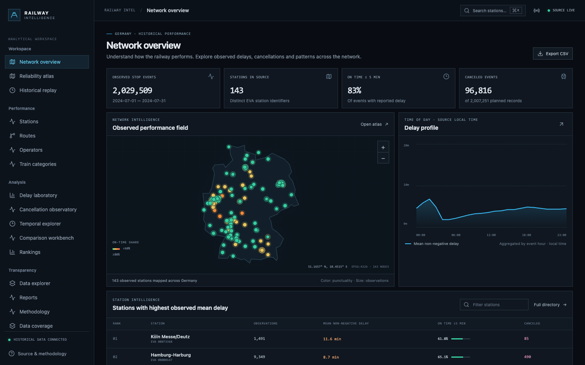
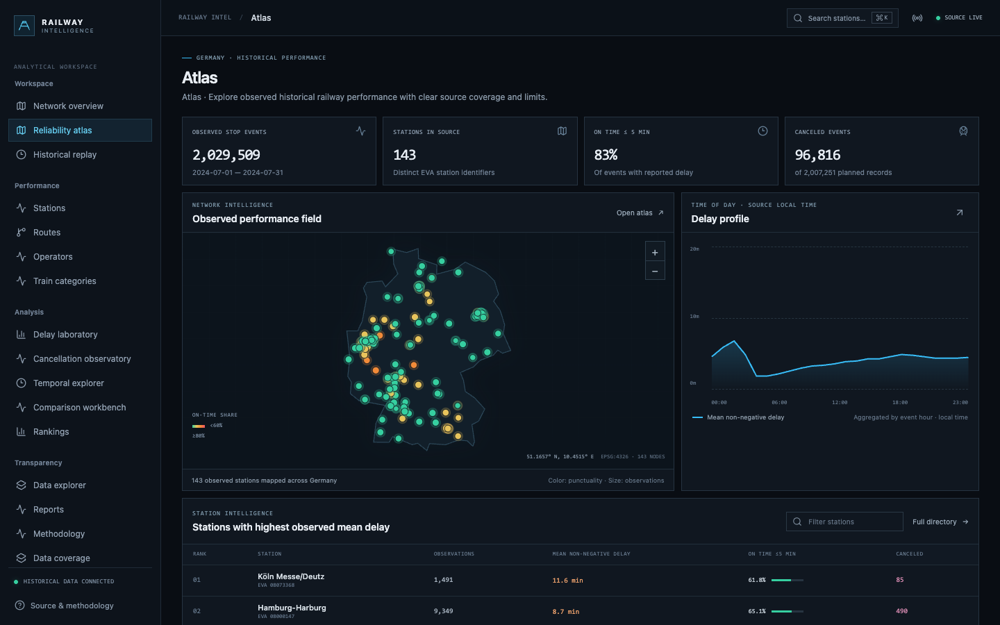
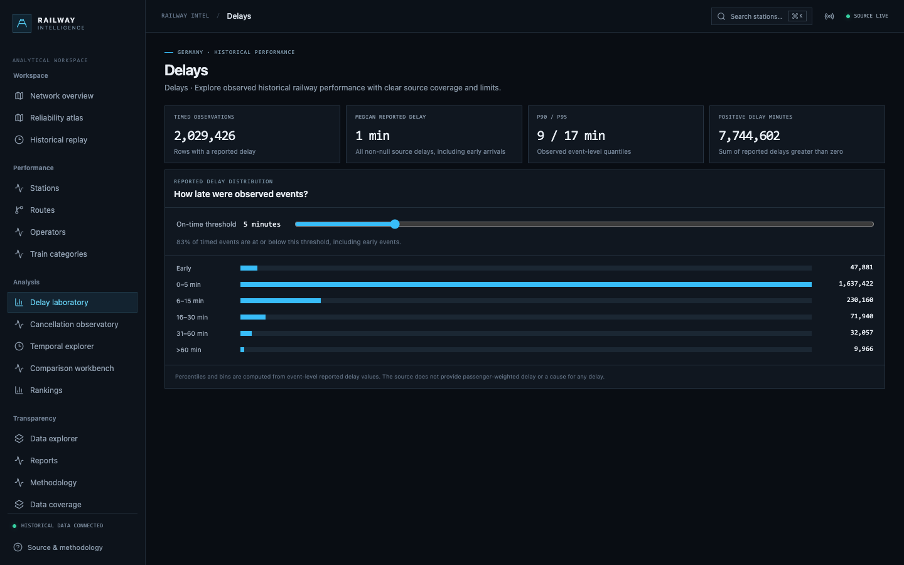
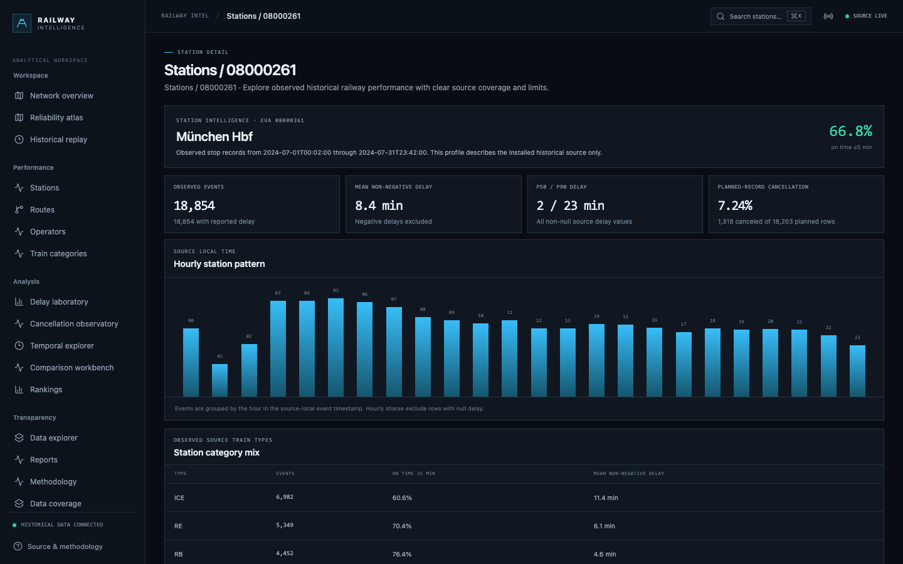
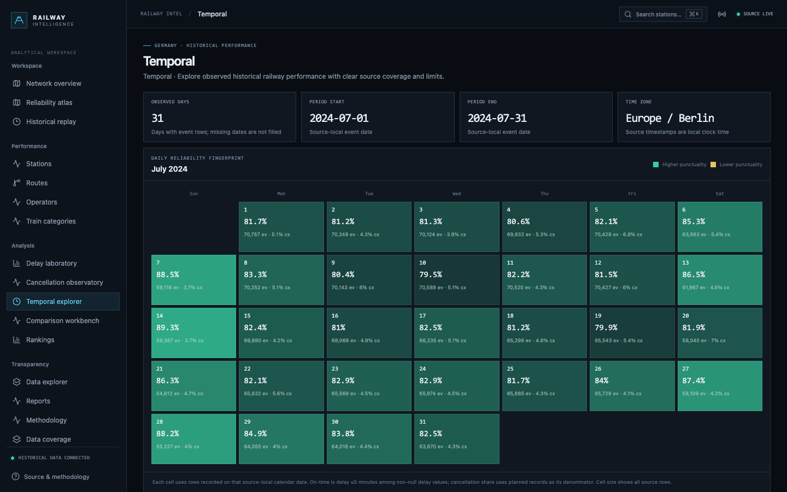
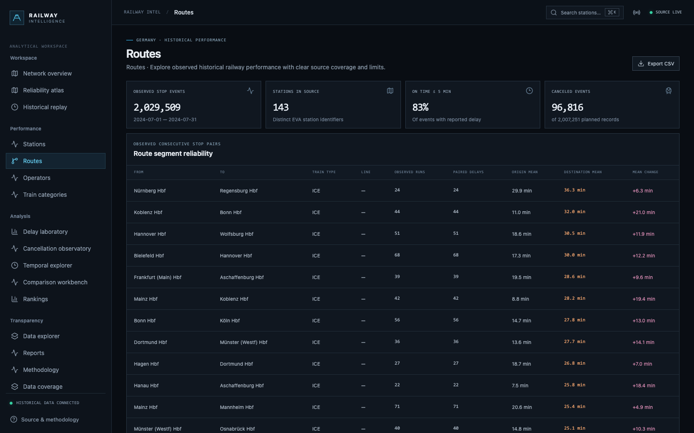
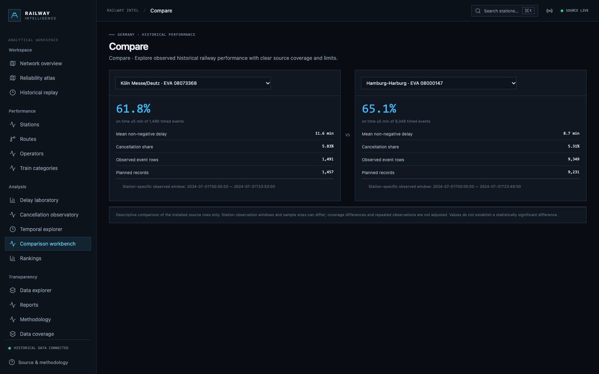
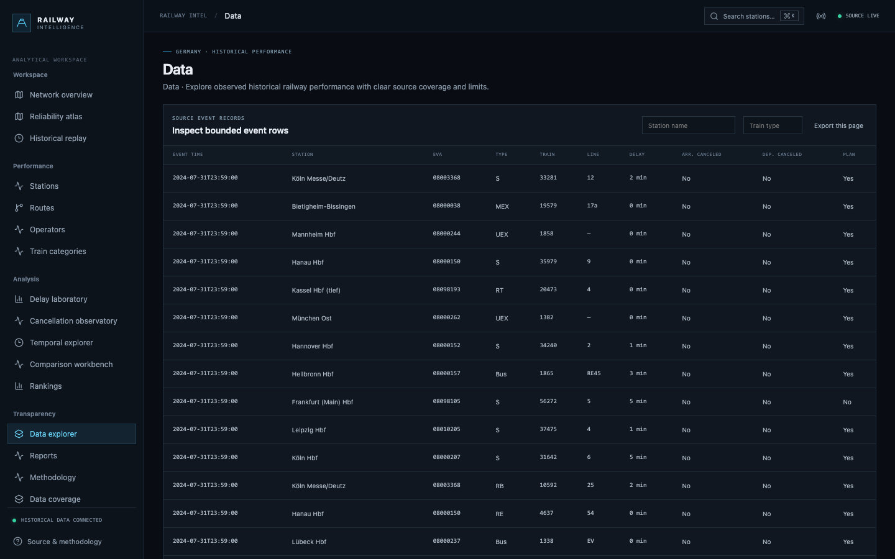
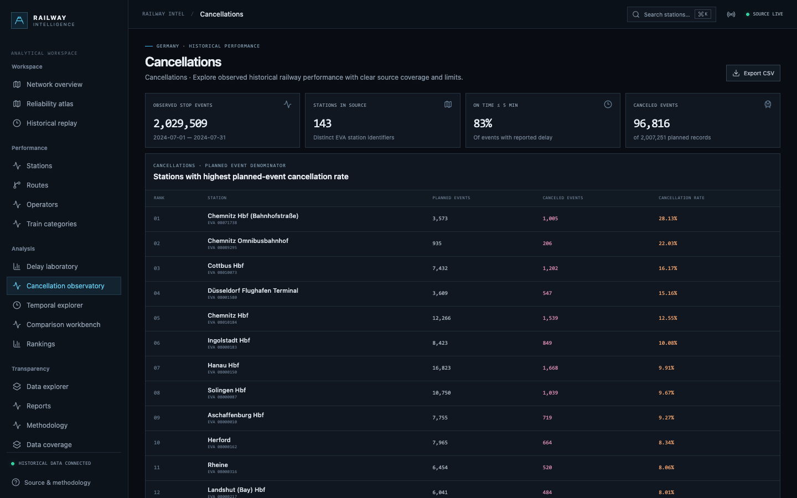

# Railway Intel

**Railway Intel** is an independent historical railway reliability intelligence workspace and analytics engine for Germany. It ingests, validates, models, and visualizes observed stop-level events from the public Deutsche Bahn timetable history dataset without relying on synthetic or simulated figures.

The stack combines a Polars data ingestion pipeline, local DuckDB in-memory analytical queries, dbt warehouse models, a FastAPI REST service, and a responsive Next.js workspace.



---

## The Problem

Understanding large-scale public transit reliability requires dealing with millions of real-world operational events, varying sample distributions, time-zone nuances, and inconsistent station coverage:

- **Volume and Performance**: Analyzing millions of raw stop records in traditional relational databases is slow and resource-heavy without dedicated servers.
- **Data Integrity and Assumptions**: Event delays, cancellations, and on-time thresholds are often misrepresented when nulls, early arrivals, or missing plan records are improperly aggregated.
- **Honest Observability**: Real-world operational feeds often lack geographic coordinates or full historical continuity; analytics platforms must report these exact boundaries rather than inventing artificial fills.

Railway Intel solves this by running analytical queries directly over normalized columnar Parquet files using DuckDB, computing exact metrics with rigorous statistical denominators, and presenting findings in an intuitive interface.

---

## Key Features

- **Columnar Analytics with DuckDB & Polars**: High-throughput querying of 2,000,000+ stop events per month in milliseconds without spinning up a heavy database daemon.
- **Analytics Engineering with dbt**: Pre-aggregated staging and mart models (`stg_stop_events`, `fct_hourly_reliability`, `fct_station_reliability`) using `dbt-duckdb`.
- **FastAPI Analytical API**: Bounded, type-safe REST endpoints serving punctuality rates, delay distributions, station rankings, and consecutive route-segment metrics.
- **Interactive Analytical Workspace**: Next.js (App Router) interface with interactive Germany network map, delay distribution exploration, station drill-downs, side-by-side comparison workbench, and monthly temporal heatmaps.
- **Geographic Network Atlas**: Exact geospatial mapping of 143 observed German railway stations across the federal network, with punctuality color-coding and observation-scaled nodes.
- **Rigorous Reliability Methodology**:
  - Punctuality calculated strictly among records with reported delays.
  - Cancellations measured against planned records as the denominator.
  - Timestamps preserved in German local clock time (`Europe/Berlin`) to reflect real timetable schedules.
- **Complete Transparency & Coverage Tracking**: Clear tracking of installed monthly manifests, file sizes, schema revisions, and explicit disclosure of source coverage boundaries.

---

## Visual Showcase

### Geographic Network Atlas

Observed performance field plotting 143 measured German railway stations with geographic coordinates, punctuality color gradients, and observation density across the federal rail network:



### Delay Laboratory

Interactive delay distribution explorer with quantile metrics (P50, P90, P95), sum of positive delay minutes, and a dynamic on-time threshold slider:



### Station Profile Intelligence

Detailed single-station drill-down (e.g., München Hbf — EVA `08000261`) with hourly performance patterns and train category mix:



### Daily Reliability Fingerprint

Calendar-based temporal heatmap mapping punctuality percentages, cancellation rates, and event volumes for every day of the month:



### Consecutive Route Segment Reliability

Tracking observed train runs across consecutive station pairs to identify delay propagation across the network:



### Station Comparison Workbench

Side-by-side performance comparison of two distinct stations across volume, punctuality, mean delay, and cancellation rates:



### Raw Event Explorer

Filterable, paginated event inspection table with station and train-type search and CSV export:



### Cancellation Observatory

Ranked table of stations with the highest planned-record cancellation shares:



---

## Architecture

```text
Hugging Face Monthly Parquet (piebro/deutsche-bahn-data)
                       │
                       ▼
       Polars Schema Validation & Ingestion
         (railway_intel.cli download/normalize)
                       │
                       ▼
          Partitioned Local Parquet Storage
              (data/processed/YYYY-MM/)
                       │
         ┌─────────────┴─────────────┐
         ▼                           ▼
    DuckDB OLAP Engine          dbt-duckdb
  (FastAPI /api/v1/* queries)   (Dimensional Marts)
         │                           │
         └─────────────┬─────────────┘
                       ▼
              Next.js 16 Workspace
          (Dark-theme Analytical UI)
```

---

## Quickstart

### Prerequisites

- **Python**: 3.12 or newer
- **uv**: Modern Python package and project manager
- **Node.js**: 22+
- **pnpm**: 12+ (or npm/npx)

### 1. Clone & Configure Environment

```sh
git clone https://github.com/ranajahanzaib/railway-intel.git
cd railway-intel
cp .env.example .env
```

### 2. Install Dependencies

```sh
# Install Python dependencies and optional extras (dev, warehouse)
uv sync --locked --extra dev --extra warehouse

# Install frontend dependencies
pnpm install --frozen-lockfile
```

### 3. Ingest & Bootstrap Data

Bootstrap the initial dataset (July 2024 source release containing ~2.03 million stop events):

```sh
# Discover available published months on Hugging Face
make data-discover

# Download and normalize July 2024 data
make data-bootstrap

# Validate local data availability
make data-validate
```

### 4. Build dbt Warehouse Models (Optional)

```sh
make data-build
```

### 5. Start the Application

In terminal 1, start the FastAPI analytical backend:

```sh
make api
# Running on http://127.0.0.1:8000
```

In terminal 2, start the Next.js workspace:

```sh
pnpm dev
# Running on http://127.0.0.1:3000
```

Open [http://localhost:3000](http://localhost:3000) in your browser.

---

## CLI Reference

The `railway-intel` CLI manages dataset discovery, downloading, and validation:

```sh
# List all available published monthly Parquet datasets
uv run python -m railway_intel.cli discover

# Download and normalize a specific month (e.g., 2024-07)
uv run python -m railway_intel.cli download --month 2024-07

# Normalize an offline local Parquet file without network access
uv run python -m railway_intel.cli normalize --month 2024-07 --output data
```

---

## API Reference

The FastAPI service exposes analytical queries at `/api/v1`. Interactive Swagger documentation is available at [http://127.0.0.1:8000/docs](http://127.0.0.1:8000/docs).

| Endpoint                         | Method | Description                                                                   |
| -------------------------------- | ------ | ----------------------------------------------------------------------------- |
| `/api/v1/health`                 | `GET`  | Service status and dataset readiness                                          |
| `/api/v1/summary`                | `GET`  | Network-wide KPIs: total observations, stations, on-time %, cancellations     |
| `/api/v1/stations`               | `GET`  | Paginated station reliability directory with optional search filter           |
| `/api/v1/stations/{eva}`         | `GET`  | Station profile: delay percentiles, hourly pattern, and train categories      |
| `/api/v1/temporal/hourly`        | `GET`  | Delay and punctuality distribution by hour of day (local time)                |
| `/api/v1/temporal/daily`         | `GET`  | Daily reliability calendar metrics across the month                           |
| `/api/v1/delays/distribution`    | `GET`  | Delay quantiles (P50, P90, P95) and bucketed histogram with on-time threshold |
| `/api/v1/categories`             | `GET`  | Performance metrics broken down by train category (ICE, RE, RB, S-Bahn)       |
| `/api/v1/cancellations/stations` | `GET`  | Stations ranked by planned cancellation percentage                            |
| `/api/v1/routes/segments`        | `GET`  | Consecutive station-pair delay propagation metrics                            |
| `/api/v1/data/events`            | `GET`  | Bounded, filterable raw event row inspector (up to 100 per page)              |
| `/api/v1/coverage`               | `GET`  | Installed source manifests and metadata                                       |

### Sample Response: `/api/v1/summary`

```json
{
  "available": true,
  "observations": 2029509,
  "stations": 143,
  "coverage": {
    "start": "2024-07-01 00:00:00",
    "end": "2024-07-31 23:59:00"
  },
  "timed_events": 2029426,
  "on_time_pct": 83.0,
  "canceled": 96816,
  "planned": 2007251
}
```

---

## Testing & Quality Assurance

Run the test suite and linters to verify system integrity:

```sh
# Run backend pytest suite
make test

# Run Python linter and formatting checks
make lint

# Typecheck and lint frontend
npm run typecheck
npm run lint

# Production build verification
npm run build
```

---

## Data Sources & Attribution

- **Primary Source**: Monthly processed stop-event Parquet feed collected and published by Piet Brömmel at [piebro/deutsche-bahn-data](https://huggingface.co/datasets/piebro/deutsche-bahn-data).
- **Underlying Data**: Deutsche Bahn public timetable APIs, licensed under **CC BY 4.0**.
- **Independence**: Railway Intel is an independent open-source project and is not affiliated with or endorsed by Deutsche Bahn.
- For in-depth methodology, see [METHODOLOGY.md](METHODOLOGY.md) and [DATA_SOURCES.md](DATA_SOURCES.md).

---

## License & Custom Work

[](mailto:work@withrana.com) [](https://www.linkedin.com/in/workwithrana)
[](https://www.upwork.com/freelancers/~01bbcf6edb91a8df5f)
[](https://contra.com/ranajahanzaib/)

**License:** MIT, see [LICENSE](LICENSE). Free for personal, academic, and commercial use.

**Author:** Rana Jahanzaib

**Need this built for your stack?** Email me what you're working on: work@withrana.com
